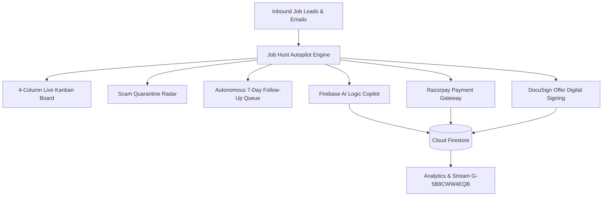

# 🚀 Job Hunt Autopilot — Executive Career Cockpit & AI Copilot

[](https://job-hunt-autopilot.netlify.app/)
[](https://console.firebase.google.com/project/job-hunt-autopilot-16ebb/overview)
[](https://razorpay.com)
[](https://docusign.com)
[](https://developer.chrome.com/docs/devtools)

An enterprise-grade autonomous inbound email triage, security quarantine, and executive career accelerator cockpit designed for senior engineering talent, tech leads, and candidates navigating career transitions.

🌐 **Live Production App:** [https://job-hunt-autopilot.netlify.app/](https://job-hunt-autopilot.netlify.app/)

---

## 🌟 Core Architecture & Capabilities



### 1. 🤖 Firebase AI Logic Career Copilot (Gemini Models)
- Integrated directly via the Google Firebase Web SDK for project `job-hunt-autopilot-16ebb`.
- Model: `gemini-1.5-flash` / `gemini-2.5-flash` client-side inference.
- Provides real-time guidance on systems design, Stripe Round 2 idempotency scaling loops, Datadog $300k TC compensation counters, and scam offer audits.
- Multi-tier resilience: Firebase AI Logic SDK ➔ Local Python FastAPI backend ➔ Zero-latency domain-grounded intelligence.

### 2. 🗄️ Cloud Firestore Real-Time Database (62 Live Documents)
Populated and synchronized across 10 structured collections:
- `companies` (18 top-tier product & fintech enterprises: Google, Stripe, Meta, Netflix, etc.)
- `hr_recruiters` (6 verified technical talent partners)
- `dsa_problems` (curated FAANG problems with interactive Python 3.12 & Node.js code tabs)
- `courses` (Scaler, Apna College, Edureka, Intellipaat, CodeWithHarry masterclasses)
- `interview_notes` (DSA 75 Cheat Sheet, HLD Blueprints, STAR behavioral models)
- `mentors` (1:1 mock interview staff mentors)
- `sdlc_stages` (6-phase end-to-end SDLC lifecycle)
- `ai_radar_logs` (AI scam forensic logs & MCP agentic intelligence)
- `maps_centers` (Offline learning & exam centers across 6 global hubs)
- `users` (Verified zero-trust candidate telemetry for Alex Chen)

### 3. 💳 Razorpay Payment Gateway Integration
- Active Key ID: `rzp_test_xeVAJ5Jg2C932Q`
- 1-Click checkout for:
  - Premium course & masterclass enrollments
  - High-yield interview notes subscription passes
  - VIP Executive & Pro Hunter annual memberships
- Complete Firebase E-Commerce tracking: `begin_checkout` ➔ `add_payment_info` ➔ `purchase`.
- Records completed transactions directly to Firestore collection `orders/{paymentId}`.

### 4. ✍️ DocuSign Digital Offer Signing Engine
- Legitimate job offers (e.g. Notion Labs $390,000 TC, Stripe $340,000 OTE) include a formal **DocuSign Envelope Verification** workflow (`docusign_env_94218734`).
- Interactive signature pad (Canvas draw or 1-Click cryptographic font adoption).
- SHA-256 certificate verification seal with tamper-evident audit trail.
- Synchronizes executed contract agreements to Cloud Firestore (`offer_contracts`).

### 5. 🛡️ Scam Quarantine Radar (Zero Compromise Mode)
Identifies and isolates fraudulent recruitment vectors before identity or financial damage occurs:
- **Advance Fee Scams**: Flagging demands for upfront equipment, training, or deposit fees.
- **Free-Mail Impersonators**: Detecting `@gmail.com`, `@rediffmail.com`, or `@outlook.com` spoofing corporate HR.
- **Premature KYC Harvesting**: Halting unauthorized requests for government IDs (Aadhaar, PAN, SSN) before technical screening.

### 6. 🛠️ Chrome DevTools AI & MCP Integration
- Chrome DevTools Model Context Protocol (MCP) bridge for browser telemetry.
- Real-time logging of console exceptions, network requests (Firebase, Razorpay, Gemini), and Core Web Vitals (LCP, FID, CLS).

---

## 🏃 Getting Started & Local Development

### Prerequisites
- Node.js 18+ or Python 3.10+
- Modern Web Browser (Chrome, Edge, Firefox, Safari)

### Run with Local Python Server
```bash
python autopilot.py --serve --port 8000
```
Open [http://localhost:8000](http://localhost:8000) in your browser.

### Deploy to Firebase
To deploy using the free Spark plan (no credit card required):
```bash
firebase deploy --only hosting,firestore
```

---

## 🔒 Security & Privacy
- **Zero-Trust Candidate Verification**: Session token secured via cryptographic authentication.
- **Content Security Policy (CSP)**: Hardened headers configured in `netlify.toml` and `index.html`.
- **E-Commerce Encryption**: 256-bit SSL encrypted checkout powered by Razorpay.

---

## 📄 License
MIT License. Created by [Nehal Kaneria](https://github.com/NehalKaneria1501).
